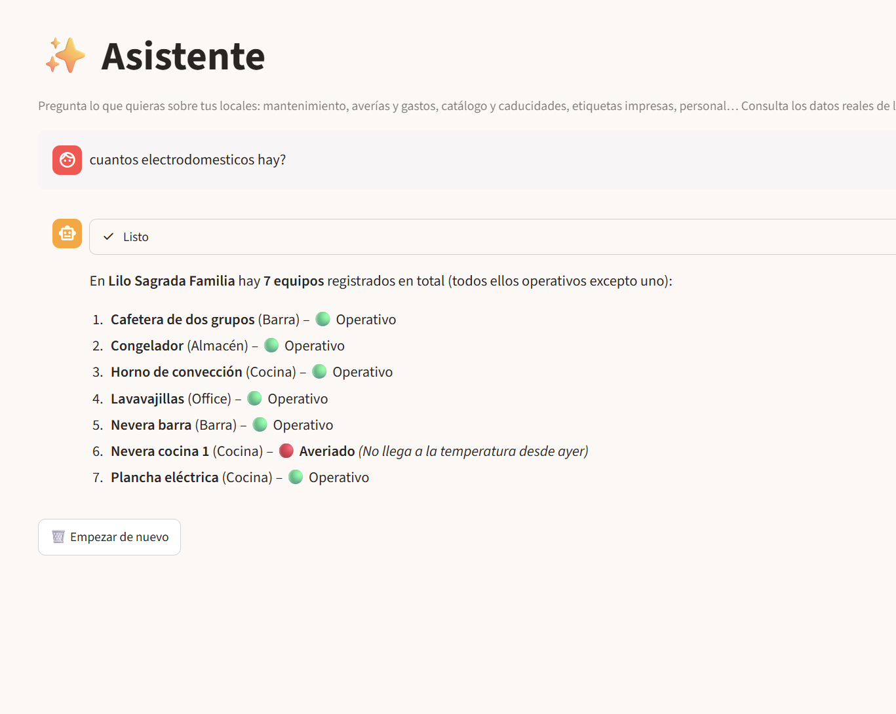
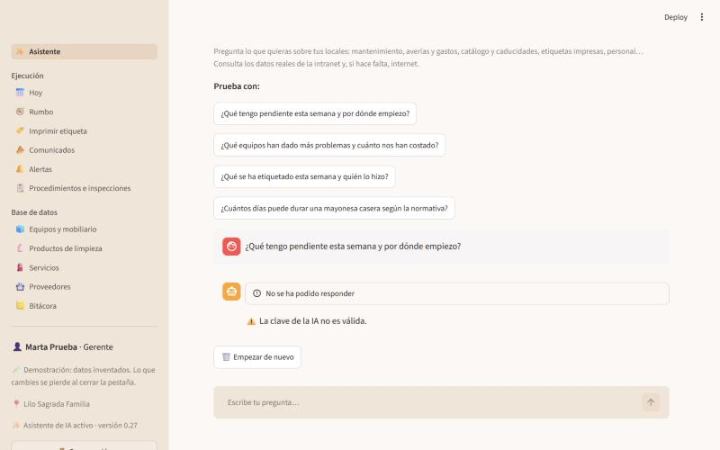
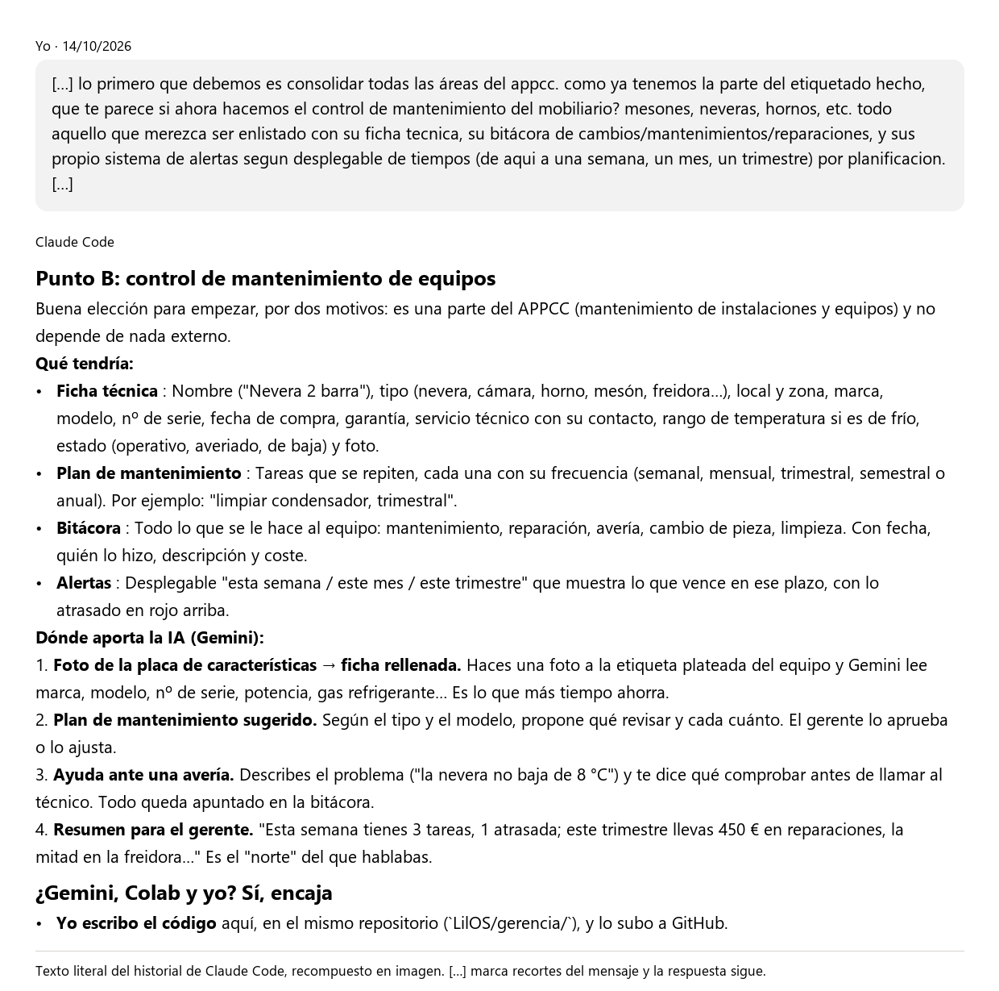
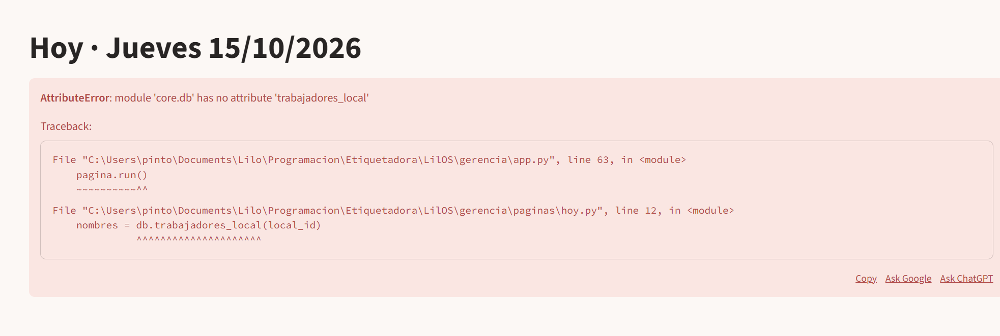

# LilOS Gerencia

**Enlace a la app:** https://lilos-gerencia-ewnoezk4zt3ej97vu4eqem.streamlit.app (es una demo con datos inventados; los PIN para entrar salen en la primera pantalla)

**Autor:** Guillermo Jesús Pinto Henriques

## Pitch

Tengo tres restaurantes y mis gerentes tienen que estar pendientes de neveras, hornos y demás máquinas mientras trabajan en sala, así que las revisiones se les pasan. Esta app les dice qué toca esta semana, guarda lo que se le ha hecho a cada máquina y avisa a dirección si algo lleva más de 7 días atrasado. La IA les contesta con los datos de la app, lee la placa de una máquina con una foto y les orienta si algo se rompe, sin tener que ponerse a buscar en papeles. Mis trabajadores lo han ido probando en el día a día y eso me ha hecho cambiar cosas: por ejemplo, en el iPhone no salía el «-» para apuntar temperaturas negativas, y al final las alertas las ve todo el equipo. Lo siguiente, que ya está en marcha, es llevar todo esto a una web propia para las tablets de cada local, con la pantalla Hoy funcionando como la lista de comprobación de un avión.

## El problema

Los gerentes son los responsables del mantenimiento de su local, pero casi nunca están en una oficina. Hoy tiran de los papeles del APPCC, de llamar a los técnicos y de memoria. Si se olvida una revisión, puede acabar en una avería en pleno servicio o en un problema de seguridad alimentaria. Y saber qué se le ha hecho a una máquina, o cuánto ha costado, es un lío.

## Qué hace la app

1. Entras con tu PIN y ves lo que tienes que hacer hoy.
2. En **Alertas** ves lo que toca esta semana, este mes o este trimestre, y lo que va atrasado.
3. En **Equipos y mobiliario** tienes la ficha de cada máquina, su garantía, su historial y lo que ha costado. La ficha se puede rellenar con una foto de la placa, y a la IA le puedes pedir un plan de mantenimiento.
4. En **Bitácora** cualquiera apunta lo que se ha hecho o lo que se ha roto. Si cumples una tarea, se calcula sola la siguiente fecha; si apuntas una avería, la máquina queda marcada como averiada.
5. En **Asistente** preguntas lo que quieras, por ejemplo: «¿Qué equipos han dado más problemas y cuánto nos han costado?».

## La IA

- **Qué usa:** Gemini, en su plan gratis (`gemini-flash-lite-latest`, y si falla, `gemini-3.5-flash-lite` o `gemini-flash-latest`). Le doy acceso a los datos de la app para que los consulte. Si necesita buscar fuera, usa Tavily o la Wikipedia.
- **Por qué:** es gratis, entiende fotos y mira los datos del momento. Y si un día quiero cambiar de proveedor, no tengo que tocar el código.
- **Si falla:** prueba con otro modelo, y si no, avisa con un mensaje normal, como «Se ha agotado la cuota gratuita de la IA por ahora. Prueba dentro de un rato.». El resto de la app sigue funcionando. Eso sí, al ser gratis, a veces tarda: he visto respuestas de hasta 30 segundos.

## Cómo la he hecho

- **Herramientas:** Claude Code para programar y Claude Design para el diseño.
- **Instrucciones para el agente:** [AGENTS.md](AGENTS.md) ([CLAUDE.md](CLAUDE.md) y [GEMINI.md](GEMINI.md) mandan ahí). Lo que tiene que hacer la app está en [especificacion.md](especificacion.md).
- **Prompts que más me han servido** (copiados tal cual de mis conversaciones; `[…]` es donde he recortado):
  1. «tengo que hacer una parte de este programa por medio de streamlit para la universidad. algo que lleve integrado la IA para resolver problemas. […] que se ocurre para hacer por alla para el trabajo del master que luego no sea un trabajo perdido?»
  2. «que te parece si ahora hacemos el control de mantenimiento del mobiliario? mesones, neveras, hornos, etc. todo aquello que merezca ser enlistado con su ficha tecnica, su bitácora de cambios/mantenimientos/reparaciones, y sus propio sistema de alertas segun desplegable de tiempos (de aqui a una semana, un mes, un trimestre) por planificacion.»
  3. «uno de los pilares de esta app es que es una app que será una solucion y no más trabajo para los trabajadores. […] debo darles flujos de trabajo con los menores clicks y menores pantallas y menores formularios posibles. quizá para implementarlo por primera vez si, pero luego tiene que funcionar como encender un avión.»
  4. «para mi admin debe haber un terminal o algun sitio donde todos los errores o warnings de la aplicacion se acumulen en lista.»
  5. «crea un perfil para la version de streamlit que no pueda dañar nada de lo que tenemos. actualmente tiene clave y si le doy la mia podran ver todo.»
- **Qué hizo el agente y qué hice yo:** el agente escribió el código, las tablas de la base de datos y las pruebas. Yo decidí qué tenía que hacer la app y cómo tenía que sentirse, usé cada pantalla y le fui pasando los fallos tal como me salían. Lo de configurar las claves en Streamlit también lo hice yo.

## Pruebas y cambios

| Quién | Qué probó | Qué pasó | Qué cambié |
|---|---|---|---|
| Yo | La pantalla Hoy | Botones enormes para textos cortos, y la plancha iba aparte | Pantalla más limpia y la plancha dentro del cierre |
| Yo | Entrar en Hoy | Saltaba un error y no se abría | Se corrigió |
| Yo | La app ya publicada | No encontraba las claves y no se entendía por qué | Un aviso que enseña los nombres de las claves que ve, nunca su valor |
| Yo | Entrar como invitado | Iba directa al PIN y no había por dónde entrar | Un botón para entrar como invitado |
| Yo | El asistente ya publicado | Se quedaba pensando y luego no respondía, porque la IA gratis a veces tarda mucho | Le di más margen de tiempo y un aviso claro si no contesta |
| Trabajadores | Apuntar temperaturas en el iPhone | El teclado no tiene «-» y no se podían poner negativas | Ya se pueden apuntar |
| Trabajadores | Ver las alertas | Solo las veía gerencia | Ahora salen en el menú de todo el equipo |
| Las chicas del equipo | Crear etiquetas | Pidieron categorías propias, filtrar por partida y una etiqueta de «abierto el día» | Añadidas |

Las tres últimas filas vienen de lo que me han ido diciendo mis trabajadores en el día a día. Esas pruebas fueron con la versión web de LilOS, que es la continuación de esta app, y con la etiquetadora. Las cinco primeras son de la app de este repositorio.

## Probarla en tu ordenador (opcional)

```bash
pip install -r gerencia/requirements.txt
streamlit run gerencia/app.py
```

Sin ninguna clave arranca con los datos inventados, que se borran al cerrar la pestaña. Para que funcione el asistente, copia `.streamlit/secrets.toml.example` como `.streamlit/secrets.toml` y pon solo `GEMINI_API_KEY`, con la clave entre comillas. Ese archivo no se sube nunca.

Si quieres usarla con tu propia base de datos, añade también las claves de Supabase, ejecuta en su editor SQL `supabase/schema.sql`, `supabase/mantenimiento.sql`, `supabase/appcc.sql`, `supabase/comunicados.sql` y `supabase/acceso.sql`, y crea la primera cuenta con `python gerencia/crear_admin.py`.

Para las pruebas automáticas: `pip install pytest` y `pytest gerencia/tests`.

Este repositorio es solo la entrega del máster. No están ni la etiquetadora, ni datos reales, ni claves. La versión que enseña la app se lee de `package.json`.

## Capturas

**La app funcionando:** el asistente contestando en la app publicada, con datos inventados.



**Cuando algo falla:** el aviso que sale si la clave de la IA no vale.



**Trabajando con la IA:** el prompt del 14 de octubre con el que empezó esta app y lo que me devolvió Claude Code. Es el texto literal de la conversación, pasado a imagen.



**Una prueba:** un error que me salió al abrir Hoy el 15 de octubre, y que se corrigió.


